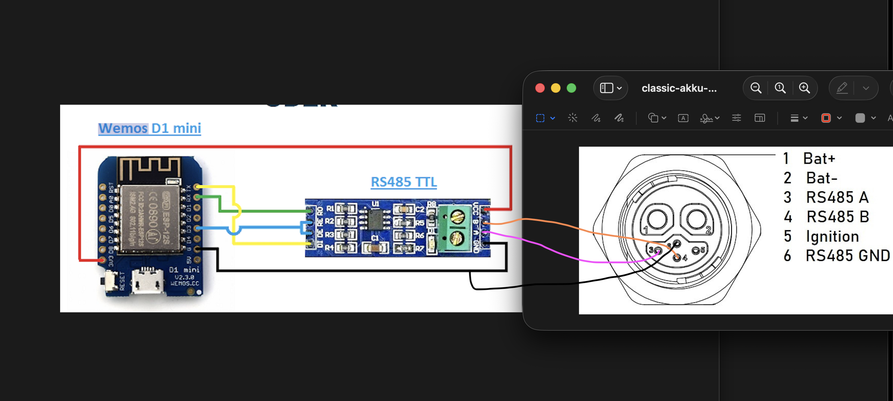

# unu-classic-esphome

[ESPHome](https://esphome.io) projects for the **unu Scooter Classic** – small
ESP-based helpers that read data from the scooter's components and bring it into
Home Assistant.

## Projects

| Project | What it does | Status |
|---|---|---|
| [Unu-classic-akku-rs485](#unu-classic-akku-rs485) | reads the battery BMS over RS485 | working on the bench |

More components may follow. Each project has its own section below and its own
ESPHome YAML file.

---

## Unu-classic-akku-rs485

ESPHome firmware that reads the battery management system (BMS) of a
**unu Scooter Classic** battery over **RS485** and publishes it to Home Assistant.

An ESP8266 (Wemos D1 mini) and a MAX485 module talk to the battery's data
connector. The battery's own protocol is parsed **in plain YAML** – no external
component, no custom C++ files.

```
Home Assistant ◄── WiFi / ESPHome API ── D1 mini ── MAX485 ── RS485 ── unu Classic battery (BMS)
```

> ⚠️ **High voltage.** The battery connector also carries the full pack voltage
> (~50 V DC, 28.5 Ah). Only the three RS485 pins are used here. Keep Bat+ far away
> from the logic side. You work on the battery at your own risk.

### Features

- Polls the BMS with the correct request frame and validates every answer
  (frame checksum, length checksum, length field, structural parse).
- Home Assistant sensors: **voltage, current, cycles, SOH, temperature 1–5**.
- Everything else – all 14 cell voltages, cell min/max/delta, remaining and full
  capacity, SoC, unknown fields – is written to the **DEBUG log**.
- Full request and response frames in the log, including checksums, so new
  battery variants can be analysed.
- **Auto poll** switch (every 3 s, off by default) and **Poll now** button.
- Sensors become *unavailable* after 3 unanswered polls in a row.

### File

| File | Purpose |
|---|---|
| [`Unu-classic-akku-rs485.yaml`](Unu-classic-akku-rs485.yaml) | the complete ESPHome configuration |
| `secrets.yaml` | your own WiFi/API credentials – **not part of the repo** |

### Hardware

| Part | Notes |
|---|---|
| Wemos D1 mini (ESP8266, 4 MB) | [the YAML](Unu-classic-akku-rs485.yaml) uses `board: nodemcu` – same chip and pin mapping |
| MAX485 RS485-TTL module | powered from **3.3 V** (keeps RO at a safe level for the ESP8266) |
| connector / wires to the battery's 6-pin data connector | only pins 3, 4 and 6 are used |

#### Wiring



| D1 mini | MAX485 | Battery connector |
|---|---|---|
| TX (GPIO1) | DI | |
| RX (GPIO3) | RO | |
| D3 (GPIO0) | DE + RE (bridged) | |
| 3V3 | VCC | |
| G | GND | pin 6 – RS485 GND |
| | A | pin 3 – RS485 A |
| | B | pin 4 – RS485 B |

Battery connector: 1 Bat+, 2 Bat−, **3 RS485 A**, **4 RS485 B**, 5 ignition,
**6 RS485 GND**.

Notes:

- The bus uses the hardware UART (GPIO1/GPIO3), so serial logging is disabled
  (`logger: baud_rate: 0`). Logs are available over WiFi.
- DE/RE on GPIO0: HIGH = transmit, LOW = receive. GPIO0 is a boot strapping pin;
  the board's pull-up keeps it HIGH at boot, so a few boot-ROM bytes go onto the
  bus. That is harmless – don't add a pull-down.
- Don't power the MAX485 from 5 V unless you add a level shifter on RO.

### Installation

1. Install [ESPHome](https://esphome.io) (tested with **2026.10.1**).
2. Put [`Unu-classic-akku-rs485.yaml`](Unu-classic-akku-rs485.yaml) into your ESPHome config folder.
3. Add these keys to your `secrets.yaml`:

   ```yaml
   librescoot_api_key: "<32-byte base64 key, see esphome.io/components/api>"
   librescoot_wifi_ssid: "<your WiFi>"
   librescoot_wifi_pw: "<your WiFi password>"
   librescoot_fallback_ap_pw: "<password for the fallback hotspot>"
   ```

4. Flash the ESP board.

> Without a Home Assistant connection the device reboots every 5 minutes
> (`api: reboot_timeout: 5min`). That is ESPHome behaviour, not an RS485 problem.

### Configuration

All settings are `substitutions:` at the top of [`Unu-classic-akku-rs485.yaml`](Unu-classic-akku-rs485.yaml):

| Substitution | Default | Meaning |
|---|---|---|
| `bms_request` | `210F4642E002FFFCF4` | request frame without `~` and `\r` (see below) |
| `bms_poll_interval` | `3s` | poll interval while **Auto poll** is on (default off) |
| `bms_max_failures` | `3` | unanswered polls in a row before sensors go unavailable |
| `nominal_capacity_ah` | `28.5` | nameplate capacity, base for SOH |

#### Home Assistant entities

| Entity | Unit | Notes |
|---|---|---|
| Voltage | V | pack voltage, 10 mV resolution |
| Current | A | 10 mA resolution; sign convention (charge/discharge) not yet verified |
| Cycles | – | cycle count reported by the BMS |
| SOH | % | full capacity (from the BMS) ÷ `nominal_capacity_ah` |
| Temperature 1–5 | °C | 1 °C resolution |
| Auto poll | switch | polls every `bms_poll_interval`; **off by default**, state restored after reboot |
| Poll now | button | sends a single request |

#### DEBUG log

Log tag `unu_bms`. One poll looks like this:

```
[D][unu_bms]: TX (18 chars): ~210F4642E002FFFCF4\r
[D][unu_bms]: TX checksum: sent FCF4, correct FCF4
[D][unu_bms]: RX (128 chars): ~210F46009070010E0FC10FBE…0BB8E4DC\r
[D][unu_bms]: Header: VER 21 ADR 0F CID1 46 RTN 00 LENGTH 9070 (LENID 112)
[D][unu_bms]: Checksum OK: E4DC
[D][unu_bms]: INFO byte 0: 01, M=14 K=5 P=4
[D][unu_bms]: Cells mV: 4033 4030 4031 4030 4032 4029 4031 4032 4034 4034 4036 4033 4033 4033
[D][unu_bms]: Cells: sum 56451 mV, min 4029 mV, max 4036 mV, delta 7 mV
[D][unu_bms]: Remaining capacity: 17.95 Ah
[D][unu_bms]: Full capacity: 19.50 Ah, SoC 92.1 %
[D][unu_bms]: Item 3 (unknown): 0 (0x0000)
[D][unu_bms]: Item 4 (unknown): 3000 (0x0BB8)
```

#### Error handling

| Problem | Log | Sensors |
|---|---|---|
| frame checksum, length checksum or length field wrong | `E` | **still published** |
| no `~`, non-hex characters, no `\r`, frame too short | `E` + hex dump | not updated |
| BMS error code (RTN ≠ `00`) or field layout doesn't fit | `E` | not updated |
| no valid answer within 500 ms | `W` | unavailable after `bms_max_failures` |

### Protocol

The BMS speaks the ASCII-hex frame protocol of the Pylontech / PACE family
(YD/T 1363 style) at **9600 baud, 8N1**.

```
~ VER ADR CID1 CID2/RTN LENGTH INFO… CHKSUM \r
```

- Everything between `~` and `\r` is ASCII hex, two uppercase characters per byte.
- `LENGTH` = 4-bit length checksum + 12-bit number of INFO characters.
- `CHKSUM` = two's complement of the sum of all ASCII codes between `~` and
  `CHKSUM`, 16 bit.

#### Request

| Variant | Frame | Notes |
|---|---|---|
| **A** (default) | `~210F4642E002FFFCF4\r` | correct checksum |
| B | `~210F4642E002FFFC94\r` | what the scooter's dashboard sends – the checksum is wrong, but original BMSes answer anyway |

Variant A worked on all tested batteries. Variant B is kept in the comments of [`Unu-classic-akku-rs485.yaml`](Unu-classic-akku-rs485.yaml) as
a fallback.

#### Response (INFO field)

Parsed structurally via the counts *M* (cells), *K* (temperatures) and *P*
(extra items), so batteries with a different layout don't break the parser.

| Field | Type | Scale |
|---|---|---|
| INFO byte 0 | u8 | unknown, always `01` so far |
| cell count M | u8 | 14 |
| cell voltages 1…M | u16 | 1 mV |
| temperature count K | u8 | 5 |
| temperatures 1…K | s16 | 1 °C |
| current | s16 | 10 mA |
| pack voltage | u16 | 10 mV |
| remaining capacity | u16 | 10 mAh |
| item count P | u8 | 4 |
| item 1: full capacity | u16 | 10 mAh |
| item 2: cycle count | u16 | – |
| item 3, item 4 | u16 | unknown (seen: 0 / 3000) |

### Tested batteries

Three original unu Classic batteries, all **Forsee FBALCO0047**
(50.4 V, 28.5 Ah, 1436 Wh, 14S10P 18650 Li-ion):

| Battery | Cycles | Full capacity | SOH | Cell delta (at rest, ~95 %) |
|---|---|---|---|---|
| 1 | 157 | 21.75 Ah | 76 % | 14 mV |
| 2 | 65 | 19.99 Ah | 70 % | 12 mV |
| 3 | 65 | 19.50 Ah | 68 % | 7 mV |

All three answered request variant A with valid frames.

### Limitations and open questions

- **Bench use only.** The ESP actively sends requests. In the scooter, the
  dashboard already polls the battery every 0.5 s – two senders on the same bus
  collide. A listen-only mode is not implemented yet.
- The role of the ignition pin (5) is not documented here. Forum reports say the
  main terminals sit at ~27 V until the battery is activated.
- Current sign convention (charge vs. discharge) is not verified yet.
- INFO byte 0 and items 3/4 are unknown. Item 4 is not the nameplate capacity
  (3000 ≠ 2850) and not a temperature.
- Replacement batteries (e.g. TWS) may require variant A and may use a different
  layout – the structural parser and the raw frame log are meant to help with that.

### Troubleshooting

No answer at all? Check in this order:

1. Request variant (`bms_request`: try A, then B).
2. A/B swapped – vendors label them differently.
3. BMS not active (see limitations).
4. RO wire reconnected after the USB flash?
